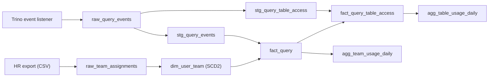

# Meta DWH for Trino table usage

A small data warehouse that tells **who uses which Iceberg tables** and **how many resources each team consumes**, with full history over time. It is built from Trino `QueryCompletedEvent` records and an HR export of team membership.

It answers questions like:

- How many distinct users queried table X during a given period?
- How many resources did team Y consume during that period?
- How does that usage change week after week?

I built the whole pipeline in Python and SQL on top of DuckDB, so it runs locally with one command. The SQL stays close to Trino's dialect, and the differences for running it on Trino/Iceberg are listed at the end.

---

## Quick start

Requirements: Python 3.11 or newer.

```bash
python -m venv .venv
.venv\Scripts\activate          # Windows (on Linux/macOS: source .venv/bin/activate)
pip install -e ".[dev]"
```

Build the warehouse from zero and print the answers to the example questions:

```bash
python -m meta_dwh.pipeline
```

Run the tests:

```bash
pytest
```

The demo generates 3 weeks of synthetic Trino events (4,200 queries), loads them, runs every transformation and prints the results of the example queries. The database is written to `data/meta_dwh.duckdb`, which is rebuilt on every run.

---

## Architecture

The warehouse has four layers. Each one has a single job.



| Layer | Job |
|---|---|
| **Raw** | Keeps exactly what arrived, duplicates included, so history can always be recomputed. |
| **Staging** | Removes duplicates and turns the JSON into clean, typed columns. |
| **Core** | Holds the facts. The business rules (team at query time, CPU per table) are applied here, once. |
| **Marts** | Small daily summaries for trends and dashboards. |

### Tables

| Object | Type | One row per | Used for |
|---|---|---|---|
| `raw_query_events` | table | received event | Landing zone: `query_id`, `query_end_time`, `ingested_at` and the full event as JSON |
| `raw_team_assignments` | table | user x team assignment | Landing zone for the HR export |
| `stg_query_events` | view | query | Deduplicated query with typed metrics and its `query_date` |
| `stg_query_table_access` | view | query x table x access type | Tables read (`ioMetadata.inputs`) and written (`ioMetadata.output`) |
| `dim_user_team` | view | user x period in a team | Which team a user was in on a given date (SCD type 2) |
| `fact_query` | table | query | Resources, user, team at query time, state |
| `fact_query_table_access` | table | query x table x access type | Who used each table and the CPU allocated to it |
| `agg_team_usage_daily` | table | day x team | Daily resources per team |
| `agg_table_usage_daily` | table | day x table | Daily usage per table |

---

## Key design decisions

| Decision | Why |
|---|---|
| Raw keeps the full JSON event | New or renamed Trino fields never break the load, and fields not used today stay available. |
| Duplicates are removed in staging (first arrival wins) | Delivery is at-least-once, so the same event can arrive twice. |
| A query belongs to the UTC day it ended | The completed event only exists at the end, when resources are final, so a closed day never changes. |
| Team history as SCD type 2 with half-open periods `[valid_from, valid_to)` | Past usage stays with the team the user had at that time, and on the day of a change exactly one team matches. |
| Users missing from HR go to team `unknown` (LEFT JOIN) | Team totals always add up to the cluster total; nothing is dropped. |
| CPU per table is split by bytes read | Trino reports CPU per query, not per table. The shares always add up to the query's CPU. |
| Incremental loads use a watermark on `ingested_at` | A late event has a new arrival time, so it is loaded automatically even if its query date is old. |
| Facts use `MERGE`, aggregates rebuild the affected days | Every run is idempotent, and a late event updates the day it belongs to. |
| Distinct users are counted on the fact table for any period | Distinct users can't be summed across days. |

---

## Resource metrics

| Metric | Source field | Reported as | Notes |
|---|---|---|---|
| CPU time | `statistics.cpuTime` | CPU-hours | Main metric: closest proxy for compute cost |
| Bytes read | `statistics.physicalInputBytes` | TiB | Drives the cost of scanning S3 |
| Bytes written | `statistics.writtenBytes` | TiB | |
| Queries / failed queries | `metadata.queryState` | count | Failed queries also consume resources |
| Peak memory | `statistics.peakUserMemoryBytes` | bytes, per query | Kept in `fact_query`, not aggregated (a sum of peaks has no meaning) |
| Wall time | `statistics.wallTime` | seconds, per query | Latency, not consumption |

---

## How data is updated

Ingestion and transformation are two independent processes. Events land in raw continuously, and a scheduled job (an Airflow DAG in production, `pipeline.py` locally) runs the SQL files in order:

```
sql/ddl/        01 ... 09   create tables and views
sql/transform/  01 fact_query                  MERGE new queries (watermark on ingested_at)
                02 fact_query_table_access     MERGE their table accesses + CPU split
                03 agg_team_usage_daily        rebuild the affected days
                04 agg_table_usage_daily       rebuild the affected days
```

What happens with a late event, night by night:

| Night | New events | Days rebuilt in the aggregates |
|---|---|---|
| Monday | Monday's queries | Monday |
| Tuesday | Tuesday's queries | Tuesday |
| Wednesday | Wednesday's queries + one Monday query that arrived late | Wednesday **and Monday** |

Running a step twice changes nothing. For a full refresh (a rule changes, or HR fixes a team in the past), I empty the facts and aggregates and run the same SQL: the watermark goes back to the beginning and everything is recomputed from raw.

---

## Results on the demo data

3 weeks (2026-10-19 to 2026-11-08), 4,278 raw events: 4,200 queries, 78 duplicate deliveries, 139 late events and 202 failed queries.

**Q1. How many distinct users queried `iceberg.sales.licenses` from 2026-10-26 to 2026-11-08?**
13 users, in 346 queries.

**Q2. How many resources did `data_platform` consume in the same period?**

| Queries | Failed | CPU-hours | TiB read | TiB written |
|---|---|---|---|---|
| 518 | 23 | 33.6 | 8.71 | 0.17 |

**CPU per team over the 3 weeks**

| Team | Queries | CPU-hours | TiB read |
|---|---|---|---|
| unknown | 998 | 64.9 | 17.14 |
| data_platform | 719 | 46.6 | 12.15 |
| sales_ops | 673 | 44.4 | 12.05 |
| marketing | 608 | 40.9 | 10.65 |
| product_analytics | 553 | 36.8 | 9.96 |
| finance | 649 | 35.0 | 9.73 |
| **Total** | **4,200** | **268.5** | |

`unknown` (service accounts and a contractor that are not in the HR export) is the biggest consumer, which is a finding by itself.

**Team history in action.** `kenji.arakawa` moves from `product_analytics` to `data_platform` on 2026-11-04. His 234 queries before that day count for `product_analytics` and his 70 queries after it count for `data_platform`. The weekly trend shows it:

| Week | `data_platform` CPU-hours | | `product_analytics` CPU-hours | |
|---|---|---|---|---|
| 2026-10-19 | 12.9 | `█████████████` | 14.3 | `██████████████` |
| 2026-10-26 | 13.0 | `█████████████` | 15.0 | `███████████████` |
| 2026-11-02 | 20.6 | `█████████████████████` | 7.5 | `████████` |

**CPU split across tables.** CPU follows the data read, not the number of queries: the 120 GB events table takes most of it, while small lookup tables are read just as often but cost almost nothing.

| Table | Reads | Allocated CPU-hours |
|---|---|---|
| `iceberg.telemetry.ide_events` | 531 | 215.6 |
| `iceberg.marketing.campaign_clicks` | 552 | 27.3 |
| `iceberg.telemetry.plugin_installs` | 542 | 14.7 |
| `iceberg.sales.licenses` | 494 | 5.8 |
| `iceberg.core.countries` | 539 | 0.0 |

**Why distinct users can't be summed.** For `iceberg.sales.licenses`, summing the daily distinct users of the 3 weeks gives **239**. The real number of distinct users is **13**.

---

## Tests

12 pytest tests, about 15 seconds. Each test builds its own temporary database.

| Test | What it proves |
|---|---|
| Same seed, same events | The synthetic data is reproducible |
| Events are internally consistent | create <= start <= end, wall <= CPU, bytes add up, failed queries never write |
| Duplicates are re-deliveries | Same payload, later arrival |
| Staging removes duplicates | One row per query |
| Timestamps are stored in UTC | No shift from the machine's time zone |
| Re-running transforms changes nothing | Idempotency |
| **Nightly incremental load = full load** | Loading night by night gives exactly the same four tables as loading everything at once |
| Late event updates its original day | Late data ends up in the right day |
| Team totals add up to all CPU | Nothing is lost by the team lookup |
| Allocated CPU adds up to query CPU | The CPU split never creates or loses CPU |
| Team is resolved at query date | The SCD2 history works |
| Users missing from HR go to `unknown` | Service accounts and contractors are kept |

---

## Assumptions

- Events are Trino `QueryCompletedEvent` records, delivered at-least-once into a raw table as JSON plus `ingested_at`.
- `ingested_at` is set by the landing system when the row is written, so it grows with arrival order.
- All timestamps are UTC, and a query belongs to the day it ended.
- `user` is the person's login and is unique.
- Teams come from an HR export with history (`user, team, valid_from`); users missing from it get `unknown`.
- Failed queries are kept. Reads and writes both count as usage of a table.
- Usage is assigned to the base tables listed in `ioMetadata`; views are not tracked separately.

---

## Running it on Trino/Iceberg

| DuckDB (this repo) | Trino |
|---|---|
| `payload->>'$.a.b'` | `json_extract_scalar(payload, '$.a.b')` |
| `json_each(payload, '$.ioMetadata.inputs')` | `CROSS JOIN UNNEST(CAST(json_extract(payload, '$.ioMetadata.inputs') AS ARRAY(JSON)))` |
| `MERGE ... INSERT *` | `MERGE ... INSERT (col1, col2, ...) VALUES (...)` |
| `TEMP TABLE` + `BEGIN TRANSACTION` for the aggregates | One `MERGE` upserting the recomputed days (each Iceberg commit is atomic) |
| Primary keys enforced | Not enforced by Iceberg: uniqueness becomes a data quality check |

The SQL already casts to `DOUBLE` before dividing (in Trino `bigint / bigint` is an integer division) and avoids `QUALIFY`, which Trino does not support. In production I would partition raw by `day(ingested_at)` and the facts and aggregates by `query_date`, compact small files regularly and set a retention policy on raw.

---

## Limitations and next steps

- The synthetic users pick tables randomly, so almost every table has every user. A more realistic generator would give each user habitual tables.
- Two deliveries with exactly the same `ingested_at` would both pass deduplication; a tie-breaker such as the Kafka offset would fix it.
- The team is frozen when a fact is loaded, so HR corrections in the past need a full refresh.
- The CPU split is an approximation, writes get no CPU, and memory is not aggregated yet.
- Next steps: data quality checks in the orchestrator, cost alerts, `cumulativeMemory` as a memory metric, HyperLogLog sketches for distinct users at large scale, and extra metadata: owners of service accounts, a catalog of tables with their owning team, and cost rates to turn CPU and bytes into money.

---

## Project structure

```
.
├── seeds/
│   └── team_assignments.csv        HR export (user, team, valid_from)
├── sql/
│   ├── ddl/                        tables and views, run in name order
│   ├── transform/                  incremental loads, run in name order
│   └── analysis/                   example queries
├── src/meta_dwh/
│   ├── generate_events.py          synthetic Trino events (plays the event listener)
│   └── pipeline.py                 runs the SQL in order and the local demo
├── tests/                          pytest suite
└── pyproject.toml
```

Stack: Python 3.11+, DuckDB, pytest.
